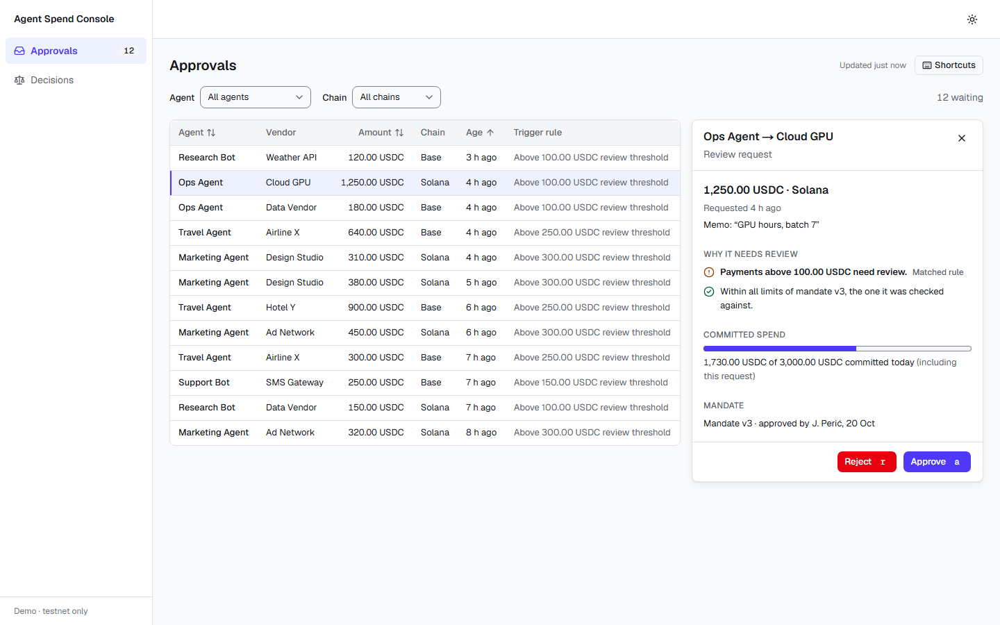
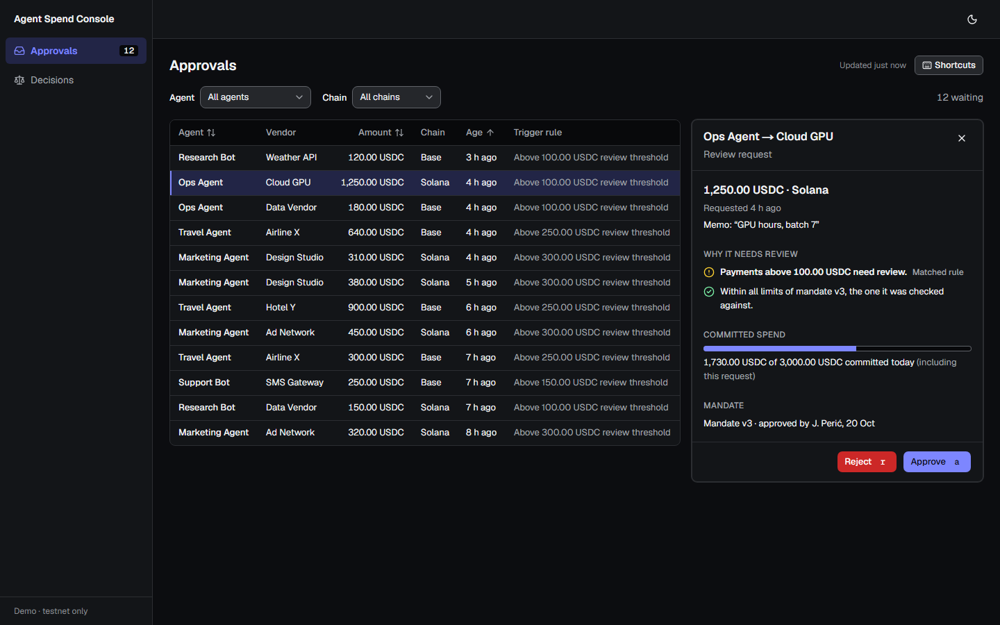
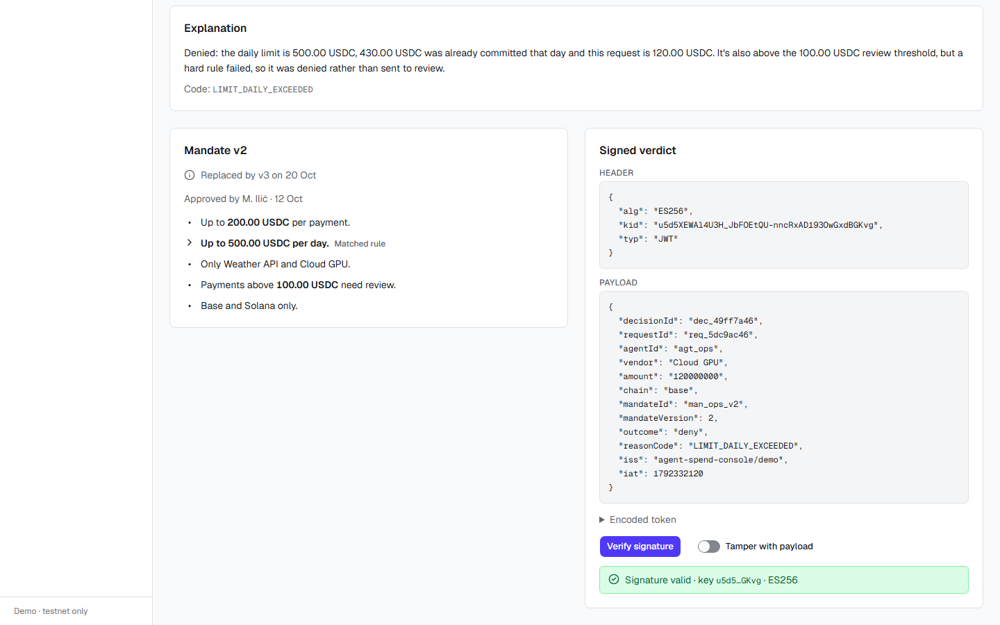
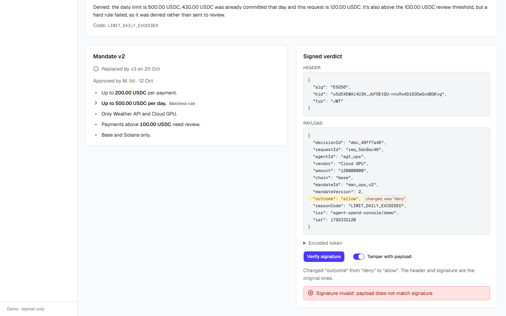
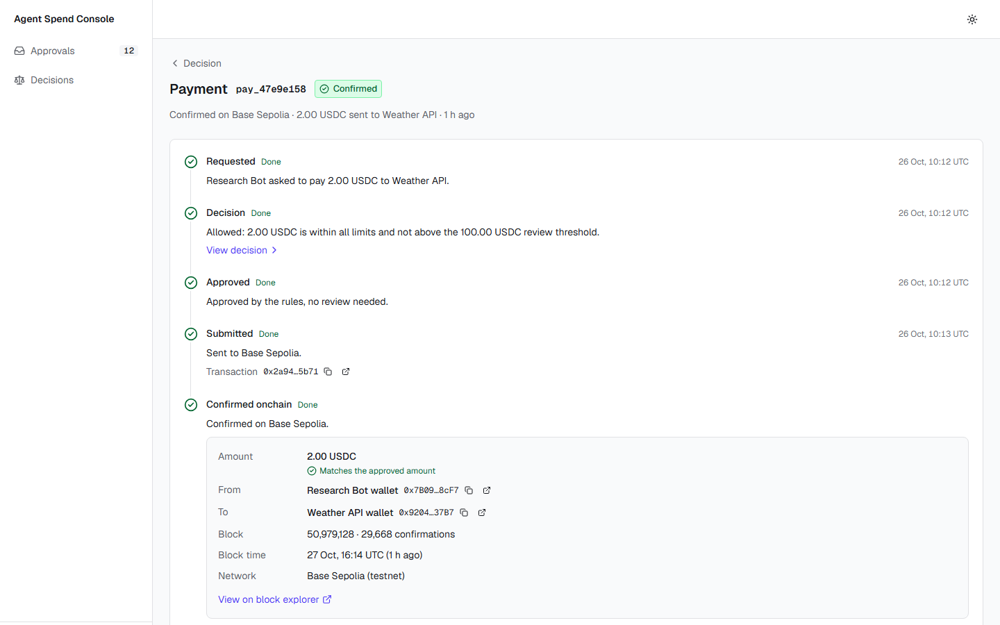
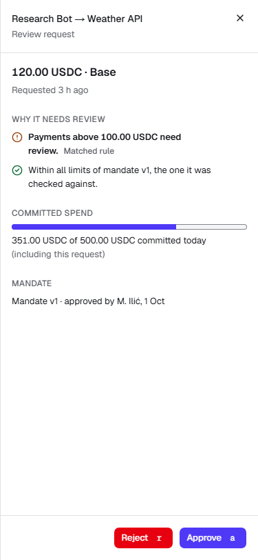

# Agent Spend Console

A portfolio demo of a finance console for AI-agent payments. AI agents ask to pay vendors in USDC; rules decide, people review, and every decision can be explained and verified.

- **Approval queue** (`/approvals`): requests above an agent's review threshold wait here. Approve with a 5-second undo, reject with a reason, and get warned when the agent's mandate changed while the request waited. Fully usable from the keyboard.
- **Decision detail** (`/decisions/[id]`): the rule outcome in plain language, the mandate that applied, and the ES256-signed verdict. You can verify it in the browser, and a **Tamper** switch shows the check failing.
- **Payment timeline** (`/payments/[id]`): from request to onchain confirmation, reading **real USDC testnet transactions** on Base Sepolia and Solana devnet.

**Live demo:** https://agent-spend-console.vercel.app


> **Not affiliated with any company.** Concepts (mandates, signed verdicts, review thresholds) are modelled generically; decision codes are invented. Testnet only and read-only onchain: no wallets, no private keys, no mainnet.

## Screenshots

| Approval queue | Dark mode |
|---|---|
|  |  |

| Signed verdict, verified | Tampered payload fails verification |
|---|---|
|  |  |

| Real Base Sepolia transfer | Mobile (375px) |
|---|---|
|  |  |

## Stack

| Area | Choice |
|---|---|
| Framework | Next.js 15 (App Router), React 19, TypeScript (strict) |
| Data | TanStack Query v5, TanStack Table v8, Zod 4 |
| UI | Tailwind CSS v4, shadcn/ui (Radix), next-themes, sonner |
| Mock API | MSW, in the browser, in every build including production |
| Signed verdicts | jose (ES256 JWT, JWKS) |
| Onchain (read-only) | viem on Base Sepolia, @solana/web3.js on devnet |
| Money | `bigint` minor units, never floats |
| Testing | Vitest + Testing Library; Playwright + axe-core for e2e and accessibility |

## Run it

Requires Node 24 and pnpm (`corepack enable`).

```sh
pnpm install
pnpm dev            # http://localhost:3000
```

Checks:

```sh
pnpm lint && pnpm typecheck && pnpm test    # also run in CI
pnpm e2e            # Playwright: approve flow, keyboard walkthrough, axe, 375px checks
pnpm screenshots    # regenerates docs/screenshots (reads the live testnet)
```

Before the first `pnpm e2e`, install the browser once with `pnpm exec playwright install chromium`. The e2e suite builds the app and serves it on port 3100 from its own `.next-e2e` folder, so it can run next to `pnpm dev`. It fakes the testnet RPCs, so it doesn't depend on public endpoints.

Optional `.env.local` (see `.env.example`): `NEXT_PUBLIC_BASE_SEPOLIA_RPC_URL` and `NEXT_PUBLIC_SOLANA_DEVNET_RPC_URL` point at a keyed testnet RPC. Without them the public endpoints are used. They work but rate-limit.

## How the demo works

- There is no backend. MSW serves a deterministic seed from the browser: 6 agents, ~200 requests over 30 days, 12 waiting for review. A reload starts over.
- Seed times follow the current day, so the demo never looks stale.
- About 10% of approve and reject requests fail on purpose, to show rollback and retry.
- Three seed payments point at real USDC transfers found on Base Sepolia and Solana devnet. Those transfers happened between unknown testnet wallets. The "Research Bot wallet" and "Weather API wallet" labels are a demo fiction.

## Key decisions

Full records with trade-offs are in [docs/decisions.md](docs/decisions.md). The design contract is in [docs/design.md](docs/design.md).

- **Waiting requests reserve spend** (D-006): approving the whole queue can never break the limits the requests were checked against.
- **Approval re-checks the current mandate** (D-007, D-013): if limits were lowered while a request waited, approving needs an explicit "Approve anyway".
- **Undo before send** (D-012): approvals are sent when the undo toast closes. Rows hide through a small overlay, so polling can't bring them back.
- **Verdicts signed with a per-load key** (D-015, D-016): the key's thumbprint is its id, the private half never leaves memory, and a verdict covers the rule decision only.
- **The mock API ships to production** (D-011): it's the demo's only backend.
- **Onchain reads are lazy and cached by finality** (D-020): viem and web3.js load only on the payment page. Settled transactions are never fetched twice.
- **e2e against a production build** (D-022): every e2e run also proves the deployed build and its service worker work.

## About

Built with AI assistance (Claude Code) and reviewed by me.
